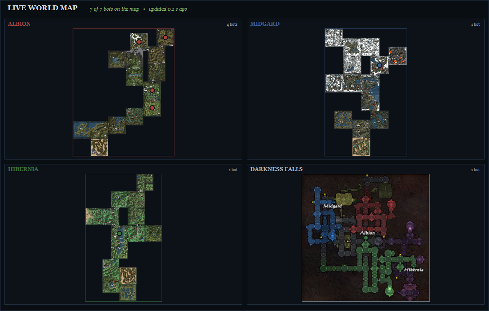
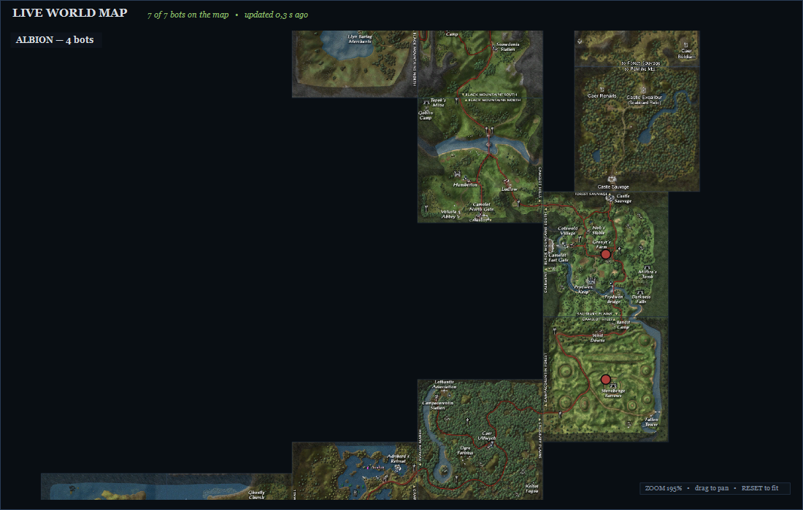

# Launcher dashboard: live world map

The launcher's **World Map** tab is a BotRealm addition (2026-11-01) that shows every online autonomous gamebot in the
world as a dot, live, with a tooltip. It is read-only: it reads the same live snapshot the Active Population tab
already uses and never changes game state.

## What it shows

- **Dots** – one small dot per online autonomous world bot, coloured by realm (Albion red, Midgard blue, Hibernia
  green, neutral gold/dim for other regions). They stay small on purpose (2026-11-02) so a crowded camp still reads as
  separate bots, and grow only a little with the zoom and on hover.
- **Realm legend** – a small plate in the bottom-left corner counts the bots currently on the map per realm, so the dot
  colours need no guessing.
- **Fade** – a dot is solid while its snapshot is at most 4 s old and fades to a faint mark over the next 20 s. Old
  data therefore stays visible but never looks current. The header shows `updated N s ago` in green/gold/red.
- **Tooltip** (hover a dot) – name; level and class and realm; the bot's current task (`Activity`, the same text
  as the Active Population grid); zone and region; snapshot age.
- **Two views** – *World overview* draws one panel per region that has bots (the three realms and their Shires when
  empty); the `VIEW` dropdown opens a single region large. A region panel is built from the world database's own
  `Zones`/`Regions` rows, so old frontiers (Forest Sauvage, Hadrian's Wall, ...), dungeons, battlegrounds, capitals
  and Darkness Falls all have their proper place. When the client is installed with its painted zone maps, those are
  drawn as the panel background; without them the same zones are drawn as realm-coloured rectangles. At 200% and closer the zone names are drawn over
  the painted map too, so a fully zoomed view still says which zone it shows.
- **Zoom and pan** – the wheel zooms about the cursor (100%–1000%, 25% a step), `+` / `−` zoom about the middle,
  `RESET` returns to the fitted view, and dragging pans a zoomed map (any mouse button; middle-drag works at any
  zoom). The map is laid out once at 100% and scaled, so the painted zone maps stay sharp; the region caption, legend,
  tooltip and `ZOOM n%` badge stay at screen size. Changing the `VIEW` region resets the zoom, so one region's zoom
  never carries into another.
- **Show on map** (2026-11-02) – right-click a bot in **Active Population** and choose **Show on map**, double-click
  its row, double-click a bot in a **Server Stats** top list (that opens the **Bot Inspector** instead, where **SHOW ON
  MAP** jumps to the map), or press **SHOW ON MAP** in the **Bot Inspector**. The tab switches, the bot's region is
  selected at 300%, the bot gets a gold ring with its name, and the camera follows it as new 2 s snapshots arrive.
  Dragging the map, pressing `RESET` or choosing another region ends the follow; the ring stays until then. A bot
  with no live position (offline, queued, or the server stopped) is reported in the launcher footer; the population
  double-click then falls back to the **Bot Inspector**.
- **Double-click a dot** – selects that bot in the **Active Population** tab: the tab comes to the front and the row is
  selected and scrolled into view. If an Active Population filter (realm, search text, online-only) would hide the
  row, the filter is relaxed first; nothing else about the selection changes.

Positions come from the server, never from the launcher: the launcher only shows what the live snapshot says.

## How the data flows

| Step | Where | What |
|---|---|---|
| 1 | launcher, every 2 s (only while the World Map tab is visible) | writes `runtime/server/bot-world.request` (a GUID) |
| 2 | server, `bots/autonomous/AutonomousBotDashboard.cs` | polls that request every 500 ms and publishes `runtime/server/state-165/bot-world.json` |
| 3 | launcher, `MainForm.WorldMap.cs` | reads the snapshot, matches each bot's `RegionId`/`ZoneId` to the `Zones` table, places X/Y on the panel and repaints |
| 4 | launcher, 1 s display clock | repaints the fade and the `updated N s ago` header even between snapshots |

The server snapshot gained these read-only fields (defaults keep old snapshots readable):

`Name`, `ClassName`, `Realm`, `RegionId`, `ZoneId`, `X`, `Y`, `Z`

## Build and deploy

Both sides changed, so deploy both (only while the game server and launcher are stopped, and keep a backup of what
you replace — AGENTS.md rules 10 and 11):

1. **Server** – build `development-source/server` Release and copy `Release/lib/GameServer.dll` and
   `Release/lib/CoreDatabase.dll` into the playable `runtime/server/`, `runtime/server/lib/` and
   `runtime/server/win-x64/`.
2. **Launcher** – build `development-source/tools/OfflineDaoc.Dashboard` Release and copy `BotRealm.*` and
   `wwwroot/` from `bin/Release/net10.0/` into the playable `runtime/` and `runtime/dashboard/wwwroot/`.
3. Start the server, then the launcher: the **World Map** tab appears between **Active Population** and
   **Active Groups**.

The map itself needs no client content: without the client's painted maps it draws the zone rectangles, and with them
it uses the painted maps. The client does not need to be running; only the server must be running for live positions.

## Verification done (2026-11-01)

- Server build: 0 errors.
- NUnit: `UT_AutonomousBotDashboard` (now includes a world-map round-trip and old-snapshot compatibility test) and the
  full suite: **3007 tests, 2938 passed, 0 failed, 69 skipped** (in-process NUnit engine because VSTest's testhost
  cannot start in this environment).
- Launcher build: 0 errors.
- The map control was rendered offscreen with synthetic snapshots against the real world database and the installed
  client's painted maps (Albion, Midgard, Hibernia and Darkness Falls; overview and single-region views) to check zone
  placement, dot placement and the painted background. The probe lives under
  `development-source/server/build/map-probe/` (git-ignored) and is not part of the shipped launcher.
- Zoom/select probe checks (same offscreen harness): overview and single-region zoom levels (100% → 156% → 195% →
  back), dots kept after zooming, `RESET` and a `VIEW` change return to 100%, and a synthetic double-click on a
  painted dot raised the bot's id while a double-click on empty map raised nothing. Renders were inspected as images
  (`world-map-overview-zoom.png`, `world-map-albion-zoom.png`). The same checks pass against the Release build that is
  deployed.
- Launcher hand-off probe: the installed `BotRealm.dll` was loaded into a headless harness run from the install's
  own `runtime/` folder (so it found the real database and server folder), the real `MainForm` was constructed
  without being shown, and it verified: the World Map tab exists in second position and holds the map control, the
  toolbar's `+`/`−`/`RESET` buttons drive the zoom percentage (125% → 100%), a synthetic row with a filter that hides
  it is relaxed and selected when the map asks for the bot (realm filter reset, search cleared, row selected, footer
  names it), and an unknown bot id reports instead of throwing. Probe source:
  `development-source/server/build/launcher-probe/` (git-ignored).
- **Not verified here:** a live in-game run with a running server, the hover tooltip and a real mouse double-click
  (the offscreen probes cannot move a real mouse or click a real window). Test those when the playable install is
  ready.

## Verification done (2026-11-02: show on map, smaller dots, 1000% zoom)

- Launcher build: 0 errors.
- The headless launcher probe was extended and run against the **deployed** `runtime/BotRealm.dll` (same harness
  as above; it constructs the real `MainForm` from the playable install and never shows a window):
  - the Active Population right-click menu lists **Show on map** (before "Inspect bot");
  - Show on map switches to the World Map tab, selects the bot's region, sets 300%, updates the `ZOOM` label and the
    footer, and the control reports following bot 42;
  - a Middle-drag clears the follow; `RESET` returns to 100%;
  - the zoom buttons reach **1000%** and `RESET` after that returns to 100%;
  - a **Bot** row in the Server Stats leaderboards switches to the Bot Inspector with that bot selected, while a
    **Player** row is reported in the status line instead;
  - the Bot Inspector's **SHOW ON MAP** button opens the map at 300% for the selected bot;
  - a bot with no live position reports it in the footer and the population double-click falls back to the Bot
    Inspector.
- **Not verified here:** a real mouse wheel and a real double-click (the offscreen probe cannot synthesize window
  input), and the 1000% rendering with the installed painted maps (the probe never shows the form). Test those in the
  playable install.

## Known limits

- Autonomous world bots only (what the Active Population tab lists); hired companions and the player's own character
  are not on the map yet.
- The `VIEW` dropdown switches region; zoom and pan are remembered only until the region changes (by design).
- Bots without a reported region (an older server build) are counted in the header but not drawn — deploying the new
  server build fixes that.
